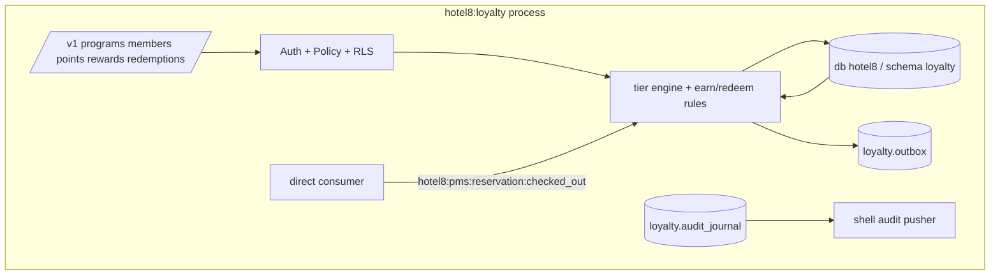

# README.md: Hotel8:Loyalty - Guest Loyalty Program

## 1. Summary

Hotel8:Loyalty is the guest-loyalty engine of the hotel8 vertical. It
defines reward programs and tiers, enrolls and links members, awards stay
points from PMS check-out events, meters earning rules across folio spends,
supports redemptions from a redemption catalog (including at the POS table),
and keeps the member's point ledger with tier progression.

## 2. Motivation

Loyalty monetizes repeat business, but reward economics must be
programmable: earn rates per tier, redemption catalogs, expiry. A dedicated
service makes economics tenant-authored data (programs, tier rules) instead
of hardcoded accounting, and it reacts to stay events so points accrue
without front-desk intervention.

## 3. Architecture & High-Level Design

## 4. Key Traits and Data Structures

- `LoyaltyRules` - pure tier-progression + earn-rate functions over the
  `loyalty.tier` enum labels (testable without a database).
- Point transactions - an append-only ledger with typed movements
  (earn/redeem/adjust/expire/transfer) and per-program scoping.
- Redemption catalog - admin-curatable reward items with cost rules.

## 5. Rationale, Trade-offs, and Alternatives

- **Append-only ledger** - balances derive from transactions; corrections are
  adjustments, never edits. Rejecting mutable balances preserves audit.
- **Event-driven stay points** - check-out is the fact that earns points;
  alternatives (scheduled scans) both lag and double-count risk.
- **Tier thresholds as rules** - progression is data + a pure function, not a
  stored rank that can drift from activity.
- **Cross-service link via PMS API** - member↔guest-profile linkage uses
  PMS's endpoint (no vertical cross-service SQL), keeping service boundaries.

## 6. Internal Implementation & Invariants (Private Design)

- Redeem requires balance ≥ cost at decision time inside the transaction -
  never a UI-only check.
- Point expiry: program-authored windows; expiry is a computed state over
  ledger entries, not a destructive rewrite.
- Member enrollment generates a unique loyalty number with provenance.
- No `unsafe` code.

## 7. Unresolved Questions / Future Designs

- Partnerships (airline miles conversions).
- Tier-match/gift benefits beyond point economics.

---

**Design attribution:** hotel8:loyalty and its underlying concepts were designed by Hamid Jahanzad <Hamid@Jahanzad.com>.
